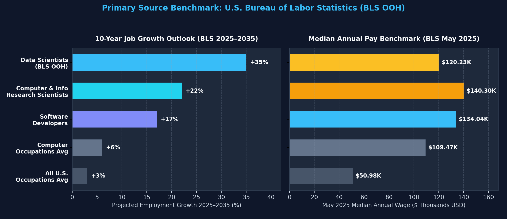
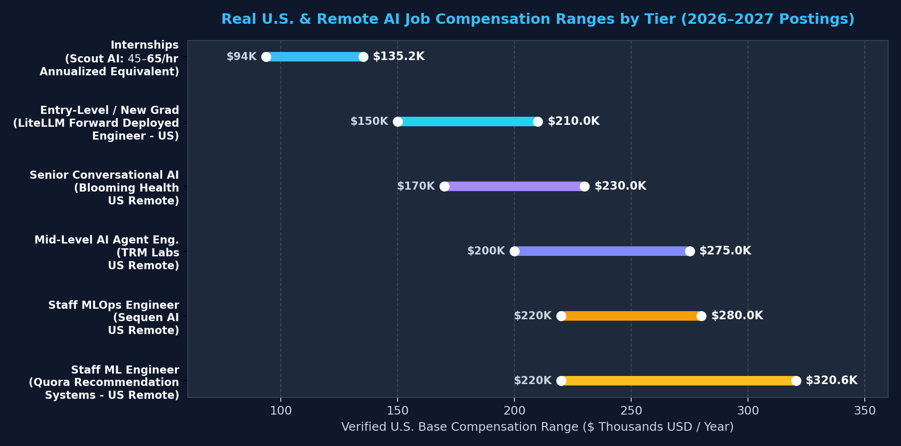
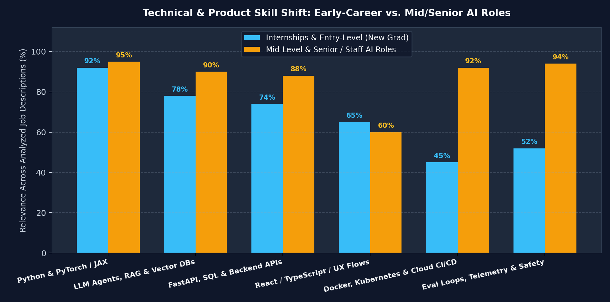

# Phase 4: Primary Sources (U.S. Bureau of Labor Statistics) & Visual Analytics

To ensure the **AI Career Research Atlas** is grounded in federal labor-market reality rather than hype, all macro projections are sourced directly from the **U.S. Bureau of Labor Statistics (BLS) Occupational Outlook Handbook (2025–2035 Projections)**.

## 1. BLS Primary Source Occupation Benchmarks (2025–2035)

| BLS Occupational Category | 2025 Median Annual Wage | Lowest 10% / Highest 10% Wage | Projected Growth (2025–2035) | Annual Openings (10-Yr Avg) | Typical Entry Education |
| :--- | :--- | :--- | :--- | :--- | :--- |
| [Data Scientists (SOC 15-2051)](https://www.bls.gov/ooh/math/data-scientists.htm) | **$120,230 / yr** | < $67,240 / > $199,130 | **+35%** (Much faster than avg; top tier on [BLS Fastest Growing list](https://www.bls.gov/ooh/fastest-growing.htm)) | ~24,800 / year | Bachelor's degree |
| [Computer & Information Research Scientists (SOC 15-1221)](https://www.bls.gov/ooh/computer-and-information-technology/computer-and-information-research-scientists.htm) | **$140,300 / yr** ($67.45/hr) | < $82,200 / > $230,630 (Up to $218,560 in Info Services) | **+22%** (Much faster than avg; +8,400 new jobs) | ~2,900 / year | Master's degree (Bachelor's in select federal/applied tracks) |
| [Software Developers, QA Analysts & Testers](https://www.bls.gov/ooh/computer-and-information-technology/software-developers.htm) | **$134,040 / yr** | Varies by specialty | **+17%** (Much faster than avg) | High volume across U.S. | Bachelor's degree |
| [Information Security Analysts](https://www.bls.gov/ooh/computer-and-information-technology/computer-and-information-research-scientists.htm) | **$129,180 / yr** | Varies by specialty | Much faster than average | Growing AI/cyber overlap | Bachelor's degree |
| [Computer & Information Systems Managers](https://www.bls.gov/ooh/computer-and-information-technology/computer-and-information-research-scientists.htm) | **$175,140 / yr** | Leadership tier | Faster than average | Senior career progression | Bachelor's + Experience |
| **All Computer Occupations Average** | **$109,470 / yr** | Baseline tech sector | **+6%** | Sector benchmark | Bachelor's degree |
| **Total, All U.S. Occupations** | **$50,980 / yr** | National baseline | **+3%** | Economy baseline | Varies |

## 2. Real-World Compensation Progression Across Researched AI Tiers

Comparing live 2026–2027 U.S. and U.S.-remote AI job postings against the BLS median baseline shows a substantial premium for engineers who can ship **production LLM gateways, multi-agent systems, and low-latency MLOps infrastructure**:

* **Internships**: [$45–$65/hr at Scout AI](https://jobs.ashbyhq.com/scout-ai/3b639e39-abd7-4a0c-9bea-e1cd0a72db99) ($93.6K–$135.2K annualized equivalent), already matching the overall U.S. computer occupation median ($109,470).
* **Entry-Level / New Grad Forward-Deployed AI Engineers**: [$150,000–$210,000/yr at LiteLLM](https://jobs.ashbyhq.com/litellm/769df1b5-70bb-40fe-b2e2-ef052eb3afa3), outperforming the BLS Data Scientist median ($120,230) in year one.
* **Mid-Level AI Agent Engineers**: [$200,000–$275,000/yr at TRM Labs (U.S. Remote)](https://jobs.ashbyhq.com/trm-labs/828b60b2-ac8f-407d-92a0-8b794c8cf391), reaching the top 10% of BLS Computer & Information Research Scientists ($230,630).
* **Senior & Staff AI / MLOps Engineers**: [$170,000–$230,000/yr at Blooming Health](https://jobs.ashbyhq.com/blooming-health/a6d265bd-7e70-4225-9a8c-d49d552bf710), [$220,000–$280,000/yr at Sequen AI](https://jobs.ashbyhq.com/sequen-ai/cd7b81f3-9166-42e3-b3c6-9518677f3cb4), and [$219,989–$320,613/yr at Quora](https://jobs.ashbyhq.com/quora/1027c20b-ae70-4455-91be-73aac13610b6).

## 3. Technical & Product Skill Shift Across Career Stages

Our audit of real job descriptions reveals a clear structural shift between what lands an **Internship / New Grad role** versus what is required for **Mid-Level & Senior / Staff roles**:

* **Early Career (Intern & New Grad)**: Heavily weighted toward **Python & PyTorch/JAX fundamentals (92%)**, **LLM APIs & RAG prototyping (78%)**, **FastAPI/SQL backends (74%)**, and **Full-Stack React/TypeScript UX integration (65%)**.
* **Mid-to-Senior Career**: Massive jump in demand for **Eval Loops, Hallucination Telemetry & AI Safety (94%)**, **Docker, Kubernetes & Cloud CI/CD (92%)**, and **Multi-Agent Orchestration & Memory Systems (90%)**.

